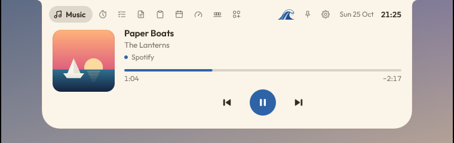

# Dyna Island



Uma ilha no topo da tela do Windows, como a Dynamic Island do celular: mostra o que está tocando, o timer de foco, volume, bateria e avisos, e abre em páginas quando o mouse passa por cima.

É um derivado enxuto do Oyenza Studio (veja [Créditos](#créditos)), **só para Windows** e **local**: não baixa add-ons, não busca letras, não tem telemetria nem verificação de atualização. A única conexão com a internet é opcional: o add-on **Outlook agenda** lê o link de calendário que você colar, e só ele (veja a aba Agenda).

## O que tem

| Aba | O que faz |
|---|---|
| **Music** | O que está tocando (Spotify, navegador, qualquer app nos controles de mídia do Windows): capa, título, barra de progresso e controles. Clicar no nome do player leva até ele |
| **Focus** | Timer Pomodoro, que continua contando na ilha fechada |
| **Tasks** | Lista de tarefas |
| **Notes** | Notas rápidas com horário: Enter salva, clique copia, × apaga (com Undo) |
| **Clipboard** | Histórico do que foi copiado (só texto, só na memória) |
| **Today** | Data, mês e um resumo do PC |
| **System** | CPU, GPU, memória, discos, rede, bateria, energia e FPS sobre jogos. O **sino** ao lado de um processo avisa na ilha quando ele terminar (com o código de saída se falhar) |
| **Agenda** | Reuniões de hoje e amanhã e a próxima contando na ilha 15 min antes (add-on **Outlook agenda**, desligado por padrão). Lê o link ICS que o Outlook publica: no Outlook.com, Configurações › Calendário › Calendários compartilhados › Publicar um calendário, copie o link ICS e clique em **Paste link**. Só aceita `https` dos endereços do Outlook, não segue redirecionamentos e lê a cada 5 min (só com o PC em uso) |
| **Dock** | Programas e atalhos escolhidos, abertos com um clique (botão **Add** escolhe o arquivo) |
| **Script** | Teleprompter sob a webcam, escondido de compartilhamentos de tela (add-on, desligado por padrão) |
| **Add-ons** | Liga e desliga o Script reader e o Outlook agenda |

A engrenagem no cabeçalho abre o **Settings** (tema; aparência em repouso; sons; tela cheia; iniciar com o Windows).

## Temas

| Tema | Como é |
|---|---|
| **Classic** | A ilha preta, como a do celular, com a cor de destaque do Windows |
| **Light** | Papel creme, tinta escura e destaque azul, com uma pequena onda inspirada em *A Grande Onda de Kanagawa*, de Hokusai: ao lado do relógio, no lugar dos olhos, no cabeçalho das páginas e no lugar do equalizador, onde balança enquanto a música toca |
| **Glass** | Vidro líquido sobre o que está atrás da ilha |
| **Pill** | Uma cápsula flutuando um pouco abaixo da borda da tela |


## Compilar e rodar

Precisa do Rust (stable) e de um toolchain para Windows (MSVC, ou MinGW-w64 com `windres` no `PATH`).

```
cargo test --workspace
cargo build -p dyna-island --release        # target\release\dyna-island.exe
```

Só uma cópia roda por vez: feche a anterior (ícone na bandeja → **Quit Dyna Island**) antes de abrir ou recompilar.

Para testar sem misturar com suas configurações, use uma pasta separada:

```
set DYNA_HOME=C:\caminho\teste
target\release\dyna-island.exe
```

### Teste automático

`dyna-island.exe --selftest <pasta>` passa por todos os estados com dados falsos, salva uma captura de cada um e escreve `report.json` com as checagens. Código de saída diferente de zero indica falha.

| Variável | Efeito |
|---|---|
| `DYNA_SELFTEST_THEME=light\|glass\|pill` | Roda todas as cenas nesse tema |
| `DYNA_SELFTEST_DPI=144` | Renderiza em 150% (também 120 e 192) |
| `DYNA_RENDERER=software` | Desenha em software em vez da GPU |

## Onde ficam os dados

- Configurações: `%APPDATA%\DynaIsland\settings.json`
- Tarefas, notas, Dock, foco e roteiro: `%APPDATA%\DynaIsland\data.json`
- Log: `%LOCALAPPDATA%\DynaIsland\dyna-island.log`

Quem usava uma versão anterior (que guardava tudo em pastas `Poni`) não perde nada: na primeira vez que abre, o Dyna Island move essas pastas para as novas e passa o "iniciar com o Windows" para o novo executável.

## Créditos

O Dyna Island nasceu do **[Oyenza Studio](https://github.com/lucacadalora/oyenza-studio)**, de Luca Cada Lora / Jatevo Labs, publicado sob a licença MIT. Quase todo o motor da ilha (desenho, animações, mídia, foco, sistema, temas) é trabalho do projeto original. Obrigado!

O que mudou em relação ao original:

- **Saiu:** Shelf e envio de arquivos pelo celular, Oyenza (dinheiro), Health, Prayer times, letras sincronizadas (LRCLIB e Apple Music), download de add-ons e o dicionário japonês, o gravador de tela, o app para Mac, o site e a publicação na loja.
- **Saiu a marca:** o nome Oyenza Studio, o logo e o gato Oyen não fazem parte deste projeto. O tema Oyen virou o tema **Light**: creme e azul, com a onda no lugar do personagem (`crates/dyna-island/src/wave.rs`). O ícone e as imagens do instalador foram redesenhados (`tools/make_icon.py`).
- **Entrou:** as abas Dock, Notes e Agenda (link ICS do Outlook.com), o sino que avisa quando um processo termina e o atalho para o app que está tocando.

Este projeto não é afiliado ao Oyenza Studio nem à Jatevo Labs.

## Licença

[MIT](LICENSE). O aviso de copyright do projeto original continua no arquivo de licença, ao lado do deste. [THIRD-PARTY-NOTICES.txt](THIRD-PARTY-NOTICES.txt) traz as licenças das bibliotecas usadas.
